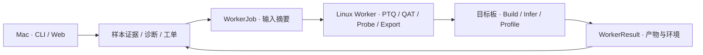

# QuantDoctor 产品架构

## 产品承诺

从一条退化样本开始，指出**在哪个边界开始偏离、证据够不够、下一次实验该改哪一项**。首个用例是 Qwen3-ASR-0.6B NVFP4 空转写。目标用户可以在 Mac 审阅和编排实验，在 NVIDIA Worker 量化或训练，在目标板验证。首选交付物是可复验的工单和诊断报告。通过目标验收的 checkpoint 可以随报告交付。浮点 HF 仅在权重修复实验能复现收益时考虑输出。

## 模块与职责

| 模块 | 职责 | 当前状态 |
|---|---|---|
| Run Model 与导入 | 记录运行来源、有效精度与比较条件，按样本 ID 配对，保留缺失和失败。 | 已实现对照合同和 Edge-LLM JSON 导入。真实报告接入待做。 |
| ASR 数据清单 | 分离校准与评测，记录有序音频内容摘要并准备请求。 | 已实现本地校验、校准 callable 和评测 bundle。设备执行待验证。 |
| ASR Evaluator 与分诊 | 计算配对 CER/WER、空转写，区分 EOS、清理异常、失败和缺证据。 | 已实现基础规则和逐步 EOS 分差对齐。板端采集、音频边界证据和置信区间待做。 |
| Planner 与 Web | 展示证据、提出单变量改变、导出工单。规划逐组干预后再细化到层。 | 已实现本地样本视图、工单、三组复验对照和 [EOS 分差图](DECODE_EVIDENCE.md)。设备实测和多候选排序待做。 |
| Model Inspector | 从 HF config 与 safetensors 头部解析张量 shape、dtype、ties 和组件体积，按需核对实际张量内容。 | 已实现 [本地检查和变更审计](CHECKPOINT.md)。校准、导出和 engine 之间的 FQN 映射待做。 |
| Artifact Store 与协调器 | 读取工单、解析内容摘要、物化输入、保存阶段结果。首次设备接入通过文件往返。 | 已定义离线阶段合同和 CLI 校验。产物校验、任务串联、重试与缓存待做。 |
| Backend Adapter | 版本绑定的 PTQ、QAT、模型探针、ONNX 导出、Engine Build、运行与采样。 | 选择性 QAT 有独立试验性 Worker。其余保留阶段接口。实际执行均需单独验证。 |
| Target Profile | 将模型、精度和执行环境的支持证据绑定到具体阶段。 | 支持状态接口已保留。能力清单、板端探测和实测登记待做。 |

依赖方向由 CLI/Web 指向本地分诊与合同，再由协调器调用 Worker。模型库、ModelOpt、CUDA、TensorRT 只在相应 Worker 加载。ASR 规则放在任务层。将来增加 TTS 时独立定义语音输出指标与组件链，增加 QNN 时实现不同的后端及 encodings 路径，共用工单与结果边界。

## NVFP4 空转写的第一条闭环

1. **分诊**。同音频与解码条件先配对，核对失败发生在 build、推理、生成停止还是清理。只有最终空文本时显示缺证据。报告 EOS 时把「观察到停止」与「精度导致停止」分别呈现。只有真实生成 token 命中有效结束 ID 才标首步 EOS。相同前缀下才比较 token 分差。
2. **介入**。如果有效精度是 NVFP4 LLM + FP8 Audio，先仅恢复 Audio 到 FP16。如果 Audio 已为 FP16 且 Head 量化，先仅恢复 Head。两者均为 FP16 时，用同板 FP8 Backbone 作质量对照，再按 Audio 输出、Decoder block、QKV/MLP 投影组排查。对 Torch 模拟已经退化和仅板端退化的案例分别保留证据。 [NVIDIA ASR 精度组合](https://nvidia.github.io/TensorRT-Edge-LLM/user_guide/examples/asr.html#supported-precision-combinations)
3. **因果与验收**。保存母候选、单变量变更、未变配置和构建产物摘要。先用原失败样本与正常对照确认方向，再用冻结留出集和同板重复测量判断是否通过。判断依据是任务恢复、空转写、CER/WER 与 RTF、内存、engine 大小。激活误差和 MSE 作为排查线索。
4. **QAT**。PTQ 与混精恢复达不到目标时才启动。固定目标量化配方、校准和评测，单独切换训练步骤。使用不重叠的校准、训练与留出集。当前 Worker 支持精确 FQN 选择、ModelOpt fake quant、转写 token CE 与 packed checkpoint 出包代码。训练损失与部署验收分开。设备阶段首先验证一层投影能反传、能打包、能构建并推理，然后对比同配方 PTQ 与 QAT。

## 设备接口与证据状态

[Worker 合同](../quantdoctor/contracts.py) 是两个独立版本化的 JSON 文档与一个 `WorkerAdapter` 接口。先手动交换文件。作业中只有工件角色和 SHA-256，执行方用独立配置把这些引用解析为本地文件。由协调器核验内容后将路径传给适配器，并提供独立的 staging 目录。作业中不携带 shell 命令、凭据和本机绝对路径。

| Stage | 输入角色 | 成功输出 |
|---|---|---|
| `ptq` | snapshot、recipe、calibration | checkpoint |
| `qat` | snapshot、recipe、calibration、training | checkpoint、training_report |
| `probe` | subject、probe_plan、requests | observations |
| `export` | checkpoint（浮点或量化）、export_config | onnx_bundle |
| `build` | onnx_bundle、build_config | engine_bundle |
| `infer` | engine_bundle、requests | responses |
| `profile` | engine_bundle、requests、profile_config | profile |

- **作业身份**来自版本、stage、backend、profile ID 和输入摘要的规范 JSON。配置变更需成为输入工件，生成新 ID。目录型工件通过稳定排序的文件清单计算摘要。对同名作业持锁，成功产物须验哈希才可发布或缓存，失败可以重试并保留日志。
- **环境身份**由 adapter 版本、Edge commit、工具链、GPU SM/设备、实际 CUDA/TRT 和插件版本组成。能力查询返回 `unverified`、`unsupported` 或 `verified`，最后一项必须有可追溯的设备验证证据。不同板卡或不同版本独立记录。Orin 首个 ASR 路径以 FP16 为基线，Thor 再验证 FP8/NVFP4。
- **执行状态**为 `succeeded`、`failed` 或 `unsupported`。成功必须提供该阶段的全部产物摘要，失败或不支持须给出原因。schema 校验只证明字段、阶段与 job 绑定正确。只有完成同目标、同配方的验收才升级为已部署验证。演示结果始终标为 `fixture`，不能晋升成设备证据。
- **证据层级**区分静态、Torch、checkpoint、ONNX、Engine Build 和板端评测。未采集与数值为零分别存储。真实数据和模型权重由用户在设备侧管理，仓库仅收公开引用、合成样本和自研实现。

当前 QAT CLI 有独立配方和本地文件入口。第一次 CUDA 验证后，再把它接入通用 `qat` 阶段合同。其他 Worker 阶段先保留类型与输入输出，不注册为可执行能力。

## 后续优先级

| 优先级 | 要做的工作 | 退出条件 |
|---|---|---|
| Mac P0 | 用已有 FP16/NVFP4 JSON 检验真实导入，补环境和输入摘要，用已实现的[修复复验](REPLAY.md)、[解码证据格式](DECODE_EVIDENCE.md)和[模型产物审计](CHECKPOINT.md)核对真实回传。 | 在本机可以用可审计数据完成样本配对、分诊和一次待验证工单。 |
| 设备 P0 | 接入同板 FP16/NVFP4 回传与一次组件恢复。先用外部 CLI 手动跑通；仅当结果不足以定位时补最小 token/音频探针。 | 原始故障稳定复现并明确报告支持或反驳的假设。 |
| 设备 P1 | 固定版本执行 PTQ、Export、Build、Infer、Profile 适配，验收选择性 QAT。 | 每个阶段产物可追溯，QAT 可与 PTQ 在同板、同配方、同数据下比较。 |
| 迭代 P2 | 实现逐层与投影组恢复、校准变化、scale 扫描、置信区间、性能与精度排序。 | 按最少实验次数定位可部署改善，结果包含失败和副作用。 |
| 后续 | 权重修复、QAD、训练恢复、多模型和跨厂商后端。 | 有新的真实用例和可重复验证的数据后逐个扩展。 |
